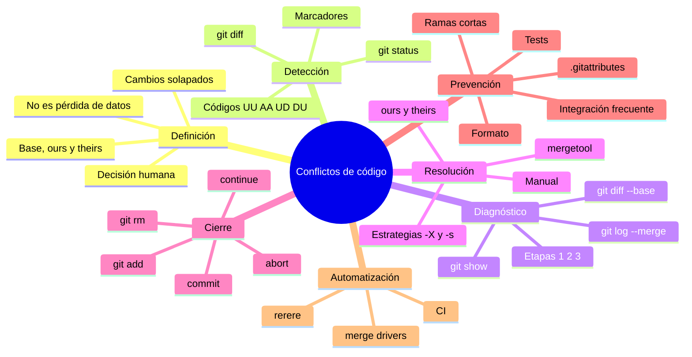
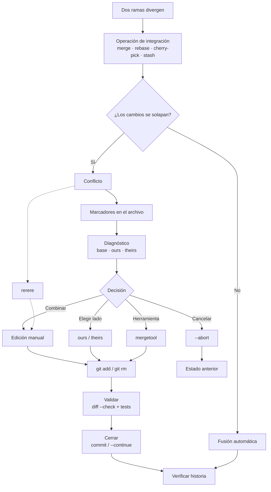

# Detección y resolución de conflictos de código (*merge conflicts*)

**Guía teórico-práctica: definición, sintaxis de comandos, procedimiento, mapas y 10 ejercicios**

> **Entorno de referencia:** Git 2.40 o superior (los ejemplos se probaron con Git 2.56 en Windows). Los comandos `git` son idénticos en Linux, macOS y Windows. Los ejemplos de creación de archivos usan **Git Bash**, incluido en Git para Windows. Al final de la sección 0 se muestra el equivalente en PowerShell.

---

## Contenido

1. Definición y conceptos fundamentales
2. Sintaxis de comandos
3. Procedimiento general de resolución
4. Mapa mental
5. Mapa conceptual
6. 10 ejercicios prácticos
7. Chuleta de comandos
8. Errores comunes
9. Checklist y autoevaluación
10. Referencias

---

## 0. Preparación del entorno

### 0.1 Requisitos

- Git instalado: `git --version`
- Una terminal: Git Bash, PowerShell, Terminal de macOS o shell de Linux.
- Un editor de texto o IDE (VS Code, IntelliJ, Vim, etc.).
- Opcional: una herramienta de merge visual (`meld`, `kdiff3`, VS Code, Beyond Compare).

### 0.2 Configuración inicial del laboratorio

```bash
git config --global user.name "Alumno"
git config --global user.email "alumno@example.com"
git config --global init.defaultBranch main

# Muestra la base común dentro de los marcadores (muy recomendable):
git config --global merge.conflictStyle zdiff3   # Git >= 2.35
# Si tu Git es más antiguo: git config --global merge.conflictStyle diff3

mkdir -p ~/labs-git/conflictos
cd ~/labs-git/conflictos
```

Cada ejercicio se realiza en una carpeta independiente. Así puedes repetirlo o comparar soluciones sin mezclar repositorios.

### 0.3 Nota para PowerShell

En PowerShell no existe `printf` como en Bash. Para crear archivos:

```powershell
# Una línea
Set-Content -Path app.txt -Value "linea 1"

# Varias líneas con here-string
@'
linea 1
linea 2
linea 3
'@ | Set-Content -Path app.txt
```

Los comandos `git` se escriben igual. Si un ejercicio indica `GIT_EDITOR=true git rebase --continue`, en PowerShell puedes usar:

```powershell
$env:GIT_EDITOR = "true"
git rebase --continue
```

### 0.4 Convenciones de esta guía

- `$` indica el prompt; no se escribe.
- `<archivo>`, `<rama>` y `<hash>` son valores que debes sustituir.
- `#` inicia un comentario.
- Cuando Git no puede fusionar, el comando termina con código de salida `1`. **No es un fallo del terminal**: es el comportamiento esperado de un conflicto.

---

## 1. Definición y conceptos fundamentales

### 1.1 ¿Qué es un conflicto de código?

Un **conflicto de código** (o *merge conflict*) es el estado en el que Git **suspende una operación de integración** porque no puede decidir automáticamente cómo combinar dos versiones de uno o más archivos.

No es un error fatal, no es una pérdida de datos y no significa que el repositorio esté roto. Es una **pausa que requiere una decisión humana**: Git ha detectado que dos líneas de historia modificaron la misma región del código y no sabe cuál de los dos cambios debe prevalecer, o cómo combinarlos.

Git fusiona texto **línea por línea** (realmente, por *hunks* o bloques de líneas). No entiende la intención del programador ni la semántica del lenguaje. Por eso:

- Si dos ramas cambian **líneas distintas**, Git suele fusionar solo.
- Si cambian **la misma línea o líneas contiguas**, Git marca un conflicto.
- Si el cambio es **semánticamente incompatible** pero está en líneas distintas, Git puede fusionar sin avisar y el código quedar roto. Eso es un **conflicto semántico**, y solo se detecta con revisión y pruebas.

### 1.2 Modelo mental: base, *ours* y *theirs*

Para resolver un conflicto hay que entender que Git maneja **tres versiones** de cada archivo en conflicto:

| Versión | Etapa en el índice | Nombre | Significado |
|---|---|---|---|
| Base | `:1:` | *merge base* | Último ancestro común de las dos ramas |
| Nuestra | `:2:` | *ours* | Versión de `HEAD`, es decir, la rama actual |
| Suya | `:3:` | *theirs* | Versión de la rama o commit que se intenta integrar |

El algoritmo de fusión de tres vías compara:

```text
diff(base, ours)  +  diff(base, theirs)  →  resultado
```

Si los dos *diffs* modifican la misma región, no hay una combinación automática segura y aparece el conflicto.

> **Cuidado:** en un **rebase**, los papeles se invierten. `ours` es la rama base sobre la que estás rebasando y `theirs` es tu propio commit que se está reaplicando. Lo veremos en detalle en la sección 1.6.

### 1.3 Causas frecuentes

1. **Misma línea modificada de forma distinta** en dos ramas.
2. **Líneas contiguas** modificadas por ambos lados (el algoritmo agrupa bloques).
3. **Modificar un archivo que la otra rama eliminó** (`modify/delete`).
4. **Eliminar un archivo que la otra rama modificó** (el mismo caso, visto al revés).
5. **Ambas ramas añaden el mismo archivo** con contenido distinto (`add/add`).
6. **Renombrados incompatibles**: ambas ramas renombran el mismo archivo de forma distinta, o una lo renombra y la otra lo edita.
7. **Archivos binarios**: imágenes, PDF, `.zip`, `.dll`, etc. No existe fusión línea a línea.
8. **Cambios de modo**: permisos de ejecución, enlaces simbólicos, submódulos.
9. **Finales de línea distintos** (CRLF en Windows frente a LF en Linux/macOS). Todo el archivo puede parecer modificado.
10. **Archivos generados** (`package-lock.json`, `yarn.lock`, minificados) que cambian a la vez en ambas ramas.
11. **Estrategias o atributos** que desactivan la fusión automática (por ejemplo, `merge=binary`).

### 1.4 Tipos de conflicto y mensajes de Git

| Tipo | Mensaje típico | Qué significa | Resolución habitual |
|---|---|---|---|
| Contenido | `CONFLICT (content): Merge conflict in app.txt` | Ambos modificaron la misma región | Editar y combinar |
| Ambos añaden | `CONFLICT (add/add): Merge conflict in README.md` | El archivo no existía en la base y ambos lo crearon | Combinar ambos contenidos |
| Modificar/eliminar | `CONFLICT (modify/delete): notas.txt deleted in feature and modified in HEAD` | Un lado borró, el otro editó | Conservar (`git add`) o borrar (`git rm`) |
| Renombrar/eliminar | `CONFLICT (rename/delete)` | Un lado renombró, el otro borró | Elegir nombre y contenido |
| Renombrar/renombrar | `CONFLICT (rename/rename)` | Ambos renombraron distinto | Unificar con `git mv` / `git rm` |
| Binario | `warning: Cannot merge binary files` | No hay fusión textual posible | Elegir un lado con `git checkout --ours/--theirs` |
| Archivo/directorio | `CONFLICT (file/directory)` | Un lado tiene un archivo y el otro un directorio en la misma ruta | Decidir estructura y `git rm` / `git add` |
| Modo | `CONFLICT (distinct modes)` | Permisos o tipo de archivo incompatibles | Ajustar modo y `git add` |
| Submódulo | `CONFLICT (submodule)` | Distintos commits del submódulo | Elegir commit y `git add` |

### 1.5 Anatomía de un conflicto

Cuando hay conflicto de contenido, Git escribe **marcadores** directamente en el archivo. Estilo clásico (`merge`):

```text
<<<<<<< HEAD
descuento = 0.10
=======
descuento = 0.15
>>>>>>> feature/descuentos
```

Estilo `diff3`, que añade la versión base:

```text
<<<<<<< HEAD
descuento = 0.10
||||||| base
descuento = 0.05
=======
descuento = 0.15
>>>>>>> feature/descuentos
```

Significado:

- `<<<<<<< HEAD`: inicio del bloque de **ours** (la rama actual).
- `||||||| base`: inicio del bloque de la **base común** (solo en `diff3`/`zdiff3`).
- `=======`: separador entre las versiones.
- `>>>>>>> feature/descuentos`: fin del bloque de **theirs** y nombre de la rama o commit que se integra.

Los marcadores son **texto normal**. Si se guardan y se confirman sin quitarlos, el archivo queda inválido para el compilador o el intérprete. Por eso siempre se valida antes de continuar.

### 1.6 Estados de un archivo en conflicto

`git status --short` muestra dos letras. En conflictos, algunas combinaciones tienen significado especial:

| Código | Significado | Ejemplo |
|---|---|---|
| `UU` | *unmerged*, modificado por ambos | Ambos editaron `app.txt` |
| `AA` | *unmerged*, añadido por ambos | Ambos crearon `CHANGELOG.md` |
| `UD` | *unmerged*, eliminado por ellos | Nosotros editamos, ellos borraron |
| `DU` | *unmerged*, eliminado por nosotros | Nosotros borramos, ellos editaron |
| `AU` | *unmerged*, añadido por nosotros | Archivo nuevo de nuestro lado, pendiente de integrar |
| `UA` | *unmerged*, añadido por ellos | Archivo nuevo de su lado, pendiente de integrar |
| `DD` | *unmerged*, eliminado por ambos | Ambos borraron |

Para ver las tres versiones con sus *hashes*:

```bash
git ls-files -u
```

Salida típica:

```text
100644 a1b2c3d4... 1	app.txt
100644 e5f6a7b8... 2	app.txt
100644 c9d0e1f2... 3	app.txt
```

Los números `1`, `2` y `3` corresponden a base, ours y theirs.

### 1.7 *Ours* y *theirs* según la operación

| Operación | `ours` (`:2:`) | `theirs` (`:3:`) |
|---|---|---|
| `git merge` | `HEAD`, tu rama actual | Rama que se integra |
| `git pull` (merge) | Tu rama local | Rama remota |
| `git rebase` | Rama base/*upstream* sobre la que rebasas | **Tu commit** que se reaplica |
| `git cherry-pick` | `HEAD` | Commit que estás recogiendo |
| `git revert` | `HEAD` | Commit cuyo efecto se revierte |
| `git stash pop` | `HEAD` / árbol de trabajo actual | Contenido del *stash* |
| `git am` | `HEAD` | Parche que se aplica |

En un `stash pop`, los marcadores no dicen `HEAD` y el nombre de la rama, sino:

```text
<<<<<<< Updated upstream
...
=======
...
>>>>>>> Stashed changes
```

`Updated upstream` es el estado actual (*ours*) y `Stashed changes` es el *stash* (*theirs*).

### 1.8 Estrategias de fusión

Git permite elegir cómo se comporta la fusión. Las más relevantes:

| Estrategia / opción | Qué hace | Cuándo usarla |
|---|---|---|
| `ort` | Estrategia por defecto en Git moderno (2.34+) | Uso general |
| `recursive` | Estrategia clásica para dos cabezas | Compatibilidad con Git antiguo |
| `resolve` | Fusión de tres vías simple | Casos muy concretos |
| `octopus` | Fusiona varias ramas a la vez | Integraciones múltiples sin conflictos |
| `ours` (`-s ours`) | Crea un merge cuyo árbol es **exactamente** el nuestro; ignora por completo el otro árbol | Marcar una rama como ya integrada, sin traer cambios |
| `subtree` | Para proyectos dentro de subdirectorios | *Vendor branches* |

Opciones de estrategia (`-X`), que **sí intentan fusionar** y solo resuelven los hunks conflictivos hacia un lado:

| Opción | Efecto |
|---|---|
| `-X ours` | En los hunks en conflicto, conserva **ours**; el resto de cambios de theirs se aplica |
| `-X theirs` | En los hunks en conflicto, conserva **theirs**; el resto de ours se aplica |
| `-X patience` | Usa el algoritmo *patience* para alinear mejor los cambios |
| `-X histogram` | Usa el algoritmo *histogram* |
| `-X ignore-space-change` | Ignora cambios de espacios al comparar |
| `-X ignore-all-space` | Ignora todos los espacios |
| `-X renormalize` | Corrige finales de línea según `.gitattributes` |
| `-X diff-algorithm=<algoritmo>` | Elige el algoritmo de diff |

> **Diferencia clave:** `-X ours` **no** es lo mismo que `-s ours`.
>
> - `git merge -X ours feature`: fusiona; los hunks conflictivos se quedan con la versión de `main`, pero los cambios no conflictivos de `feature` **sí** entran.
> - `git merge -s ours feature`: crea un commit de merge cuyo contenido es **idéntico** a `main`; **nada** de `feature` entra en el árbol. Se usa para registrar que una rama se considera integrada, no para combinar código.

### 1.9 Prevención: la mejor resolución es evitar el conflicto

- **Ramas cortas y con un solo propósito.** Cuanto más tiempo vive una rama, más diverge.
- **Integra frecuentemente** (`git pull --rebase`, merges pequeños).
- **Comunica** qué archivos está tocando cada persona; los archivos “calientes” se conflictúan más.
- **Acuerda formato y estilo** (Prettier, ESLint, EditorConfig, clang-format). Un cambio masivo de formato genera conflictos artificiales.
- **Evita mezclar refactorizaciones globales con cambios funcionales** en el mismo commit.
- **No edites archivos generados** a mano; regenéralos (`package-lock.json`, `yarn.lock`, minificados).
- **Divide archivos gigantes** en módulos más pequeños.
- Usa **`.gitattributes`** para finales de línea, binarios y *lockfiles*.
- **Revisa el diff antes de fusionar**: `git diff main...feature`.
- Usa `git merge --no-commit --no-ff` para inspeccionar una fusión antes de confirmarla.
- **Prueba después de resolver**. Un archivo sin marcadores puede seguir siendo incorrecto.
- En equipos, considera **`git rerere`** para reutilizar resoluciones repetidas.

### 1.10 Glosario mínimo

| Término | Definición |
|---|---|
| *Merge base* | Ancestro común más reciente de dos ramas |
| *Hunk* | Bloque de líneas modificadas que Git compara como una unidad |
| *Unmerged path* | Archivo con conflicto pendiente en el índice |
| *Fast-forward* | Avance de rama sin commit de merge; no puede haber conflicto |
| *Evil merge* | Merge commit que introduce cambios no presentes en ninguno de sus padres; debe evitarse |
| *Mergetool* | Herramienta visual o de terminal para resolver conflictos |
| *Merge driver* | Programa que define cómo fusionar un tipo de archivo |
| `rerere` | Reuse Recorded Resolution: reutiliza resoluciones ya registradas |

---

## 2. Sintaxis de comandos

### 2.1 Diagnóstico: saber qué pasó

| Comando | Qué hace |
|---|---|
| `git status` | Estado completo; muestra archivos en conflicto y la operación en curso |
| `git status --short` | Estado compacto (`UU`, `AA`, `UD`, etc.) |
| `git status --porcelain=v2` | Formato estable para scripts |
| `git diff` | Diff combinado de los archivos en conflicto |
| `git diff --name-only --diff-filter=U` | Lista solo los archivos no fusionados |
| `git diff --check` | Detecta marcadores de conflicto y errores de espacio |
| `git ls-files -u` | Lista las etapas 1, 2 y 3 de cada archivo en conflicto |
| `git log --merge --oneline -- <archivo>` | Commits de ambas ramas que tocaron el archivo (durante un merge) |
| `git log --merge -p -- <archivo>` | Igual, con el parche de cada commit |
| `git show :1:<archivo>` | Muestra la versión base |
| `git show :2:<archivo>` | Muestra la versión ours |
| `git show :3:<archivo>` | Muestra la versión theirs |
| `git diff --base -- <archivo>` | Diff contra la base |
| `git diff --ours -- <archivo>` | Diff contra ours |
| `git diff --theirs -- <archivo>` | Diff contra theirs |

Ejemplo de diagnóstico completo:

```bash
git status
git diff --name-only --diff-filter=U
git diff
git log --merge --oneline -- src/app.js
git show :1:src/app.js
git show :2:src/app.js
git show :3:src/app.js
```

> `git status --short` muestra los archivos, pero no siempre indica que hay un merge en curso (por ejemplo, si el contenido resuelto coincide con `HEAD`). Usa `git status` completo para ver la operación pendiente.

### 2.2 Resolución manual

| Comando | Qué hace |
|---|---|
| `git checkout --conflict=diff3 -- <archivo>` | Regenera los marcadores en estilo `diff3` (incluye base) |
| `git checkout --conflict=zdiff3 -- <archivo>` | Igual, con estilo `zdiff3` (más compacto) |
| `git checkout -m -- <archivo>` | Recrea el estado de conflicto del archivo |
| `git add <archivo>` | Marca el archivo como resuelto (queda en el índice) |
| `git rm <archivo>` | Resuelve eliminando el archivo |
| `git checkout -- <archivo>` | Solo para archivos ya resueltos: descarta cambios del árbol de trabajo (¡puede perder trabajo!) |

> Mientras el archivo sigue en conflicto, `git checkout -- <archivo>` falla con `error: path '<archivo>' is unmerged`. Para elegir una versión usa `--ours` o `--theirs`; para descartar la resolución, rehaz la operación.
>
> Cuidado con `git restore --staged -- <archivo>`: reinicia el índice a `HEAD` y **elimina las etapas 1/2/3**, pero deja los marcadores en el árbol de trabajo. No es un “deshacer el conflicto”. Si ya hiciste `git add` y quieres volver atrás, lo más seguro es `git merge --abort` y repetir la fusión. `git checkout -m -- <archivo>` solo recrea el conflicto mientras el archivo siga *unmerged*.

Flujo mínimo:

```bash
# 1. Abrir el archivo y editar
# 2. Dejar el contenido final, sin marcadores
git add <archivo>
git commit          # o git merge --continue / git rebase --continue
```

### 2.3 Elegir un lado completo

| Comando | Efecto |
|---|---|
| `git checkout --ours -- <archivo>` | Deja la versión ours en el árbol de trabajo |
| `git checkout --theirs -- <archivo>` | Deja la versión theirs en el árbol de trabajo |
| `git restore --ours -- <archivo>` | Equivalente moderno para el árbol de trabajo |
| `git restore --theirs -- <archivo>` | Equivalente moderno |
| `git checkout --ours -- .` | Aplica ours a todos los archivos en conflicto (usar con cuidado) |
| `git checkout --theirs -- .` | Aplica theirs a todos (usar con cuidado) |

> **Importante:** `git checkout --ours` y `git restore --ours` **actualizan el archivo de trabajo, pero no marcan el conflicto como resuelto**. Después debes ejecutar `git add <archivo>`. Lo mismo ocurre con `--theirs`.

Para un binario:

```bash
git checkout --theirs -- logo.png
git add logo.png
git commit -m "merge: usa el logo de feature"
```

### 2.4 Herramientas de fusión (*mergetools*)

```bash
git mergetool --tool-help          # lista herramientas disponibles
git mergetool                      # usa la configurada
git mergetool --tool=vimdiff       # fuerza una herramienta
```

Configurar VS Code:

```bash
git config --global merge.tool vscode
git config --global mergetool.vscode.cmd 'code --wait --merge $REMOTE $LOCAL $BASE $MERGED'
git config --global mergetool.keepBackup false
```

> En Windows, `code` debe estar en el `PATH` (en VS Code: *Command Palette → Shell Command: Install 'code' command in PATH*). En PowerShell, el valor con `$REMOTE` puede requerir comillas simples; si falla, configura el comando desde Git Bash.

Configurar Meld (si está instalado y en el `PATH`):

```bash
git config --global merge.tool meld
```

Uso típico:

```bash
git mergetool
# La herramienta abre 3 o 4 paneles: LOCAL (ours), BASE, REMOTE (theirs), MERGED
# Guardar y cerrar; Git marca el archivo como resuelto si la herramienta termina bien
git status
```

### 2.5 Continuar o abortar según la operación

| Operación | Continuar | Abortar | Saltar |
|---|---|---|---|
| Merge | `git merge --continue` o `git commit` | `git merge --abort` | — |
| Rebase | `git rebase --continue` | `git rebase --abort` | `git rebase --skip` |
| Cherry-pick | `git cherry-pick --continue` | `git cherry-pick --abort` | `git cherry-pick --skip` |
| Revert | `git revert --continue` | `git revert --abort` | `git revert --skip` |
| `git am` | `git am --continue` | `git am --abort` | `git am --skip` |
| Stash pop | `git add` + `git stash drop` | `git reset --merge` | — |

Notas:

- `git merge --abort` solo funciona si hay un merge en curso. Si hay cambios locales que estorban, puede fallar; `git reset --merge` es una alternativa.
- `git reset --hard` también aborta, pero **destruye cambios locales**. Úsalo solo si estás seguro.
- `git rebase --abort` devuelve la rama al estado anterior al rebase.
- `git cherry-pick --quit` olvida la operación en curso pero **conserva** los cambios ya aplicados.
- `git stash pop` con conflicto **no elimina el stash**; queda en la lista hasta que lo resuelvas y ejecutes `git stash drop`.

### 2.6 Estrategias y configuración

```bash
# Resolver hunks conflictivos a favor de un lado (el resto se fusiona)
git merge -X ours <rama>
git merge -X theirs <rama>

# Ignorar por completo el árbol de la otra rama
git merge -s ours <rama>

# Revisar antes de confirmar
git merge --no-commit --no-ff <rama>

# Fusionar sin crear commit de merge (squash)
git merge --squash <rama>

# Permitir historias no relacionadas
git merge --allow-unrelated-histories <rama>

# Estilo de marcadores
git config --global merge.conflictStyle zdiff3

# Reutilización de resoluciones
git config --global rerere.enabled true
git config --global rerere.autoUpdate true
```

### 2.7 `.gitattributes`: prevenir y automatizar

Ejemplo de `.gitattributes`:

```gitattributes
# Normaliza finales de línea
* text=auto eol=lf

# Binarios: no intentar fusionarlos como texto
*.png binary
*.jpg binary
*.pdf binary
*.zip binary

# Lockfiles: concatenar líneas en conflicto (usar con precaución)
package-lock.json merge=union

# Un driver propio llamado "ours"
*.lock merge=ours
```

Para que `merge=ours` funcione hay que definir el driver (no basta con el atributo):

```bash
git config merge.ours.driver true
```

- `merge=union` es un driver integrado: concatena las líneas conflictivas sin marcadores. Puede producir contenido inválido (por ejemplo, JSON duplicado), así que en *lockfiles* suele ser mejor **regenerar** el archivo.
- `merge=ours` conserva silenciosamente la versión actual; es cómodo, pero **oculta cambios** y puede ser peligroso. Úsalo solo en archivos donde la rama principal manda.
- La configuración de un driver (`merge.ours.driver`) es local; no se propaga con el clon. Documéntala o inclúyela en un script de configuración del proyecto.

Después de cambiar las reglas de finales de línea:

```bash
git add --renormalize .
git commit -m "chore: normaliza finales de línea"
```

### 2.8 `rerere`: reutilizar resoluciones

```bash
git config --global rerere.enabled true
git config --global rerere.autoUpdate true

git rerere status       # archivos que rerere está siguiendo
git rerere diff         # diff de la resolución registrada
git rerere forget <archivo>   # olvidar una resolución
```

`rerere` graba la “preimagen” del conflicto y la “postimagen” de la resolución. Si el mismo conflicto vuelve a aparecer (por ejemplo, al repetir un rebase), Git aplica la resolución automáticamente.

---

## 3. Procedimiento general de resolución

### 3.1 Flujo recomendado en 8 pasos

#### Paso 0. Entender la operación

Antes de tocar nada, identifica qué estabas haciendo:

```bash
git status
```

La salida indica si hay un merge, un rebase, un cherry-pick o un stash en curso. **No mezcles operaciones**: no empieces un rebase con un merge a medias.

#### Paso 1. Detectar los archivos en conflicto

```bash
git status --short
git diff --name-only --diff-filter=U
```

Interpreta los códigos (`UU`, `AA`, `UD`, etc.). Si hay muchos archivos, empieza por los de lógica y deja para el final los generados.

#### Paso 2. Diagnosticar cada archivo

```bash
git diff -- <archivo>            # diff combinado
git show :1:<archivo>            # base
git show :2:<archivo>            # ours
git show :3:<archivo>            # theirs
git log --merge --oneline -- <archivo>
```

Preguntas que debes responder:

- ¿Qué intentaba hacer cada lado?
- ¿Son cambios complementarios o alternativos?
- ¿Hay una base común que ayude a entender la evolución?
- ¿El archivo es texto o binario?
- ¿Es un archivo generado que debería regenerarse?

#### Paso 3. Decidir la estrategia

| Situación | Estrategia |
|---|---|
| Cambios complementarios | Combinar manualmente ambos |
| Cambios alternativos | Elegir uno y justificar |
| Un lado es claramente obsoleto | `git checkout --ours/--theirs` + `git add` |
| Binario | Elegir un lado o renombrar |
| Archivo generado | Regenerarlo con la herramienta |
| No estás seguro | Abortar y consultar; no inventes |

#### Paso 4. Editar y eliminar los marcadores

Abre el archivo y deja el contenido final. Elimina por completo:

- `<<<<<<<`
- `|||||||`
- `=======`
- `>>>>>>>`

Si usas `diff3`, la base te ayuda a ver qué había antes, pero **también hay que eliminarla**.

#### Paso 5. Validar antes de marcar como resuelto

```bash
git diff --check
git grep -n '^<<<<<<<' -- .        # no debería devolver nada
git grep -n '^>>>>>>>' -- .        # no debería devolver nada
```

Además:

- Compila o ejecuta el intérprete.
- Pasa los tests.
- Revisa que no haya duplicados ni código muerto.
- Si el archivo es de configuración, valida el formato (JSON, YAML, INI).

> `git diff --check` detecta todos los marcadores de conflicto (incluido `|||||||` de `diff3`) y también errores de espacio. Es una comprobación rápida, pero no sustituye a los tests.

#### Paso 6. Marcar como resuelto

```bash
git add <archivo>          # conservar el contenido resuelto
git rm <archivo>           # si la resolución es eliminar
```

Comprueba:

```bash
git status
git diff --cached
```

#### Paso 7. Cerrar la operación

```bash
# Merge
git commit -m "merge: integra feature/login en main"
# o
git merge --continue

# Rebase
git add <archivo>
GIT_EDITOR=true git rebase --continue

# Cherry-pick
git add <archivo>
GIT_EDITOR=true git cherry-pick --continue
```

#### Paso 8. Verificar y documentar

```bash
git status
git log --oneline --graph --all --decorate -10
git show --stat HEAD
```

- Confirma que la historia tiene la forma esperada.
- Ejecuta la suite de pruebas una vez más.
- Si hiciste un rebase de una rama compartida, coordina antes de hacer `push --force-with-lease`.
- Deja un mensaje de commit que explique **cómo** se resolvió, no solo “fix conflict”.

Plantilla de mensaje:

```text
merge: integra feature/login en main

Resolución:
- app.txt: se conservan la validación de main y el mensaje de feature.
- config.ini: se acepta nivel=debug de feature.
- logo.png: se usa la versión de feature.

Probado: npm test (12/12) y npm run build.
```

### 3.2 Diagrama de decisión

```text
Operación de integración (merge / rebase / cherry-pick)
        │
        ▼
¿Git fusiona automáticamente?
        │
        ├── SÍ ──► Auto-merge ──► verificar
        │
        └── NO ──► CONFLICTO
                      │
                      ├── Diagnosticar (:1:, :2:, :3:)
                      │
                      ├── Decidir
                      │     ├── Combinar manualmente
                      │     ├── Elegir ours / theirs
                      │     ├── Usar mergetool
                      │     └── Abortar (--abort)
                      │
                      ├── git add / git rm
                      │
                      ├── Validar (diff --check + tests)
                      │
                      └── commit / --continue ──► verificar historia
```

### 3.3 Particularidades por operación

| Operación | Señal de estado | `ours` | `theirs` | Comando de cierre |
|---|---|---|---|---|
| `merge` | `You have unmerged paths` | Tu rama (`HEAD`) | Rama integrada | `git commit` / `git merge --continue` |
| `rebase` | `rebase in progress` | Rama base/*upstream* | Tu commit reaplicado | `git rebase --continue` |
| `cherry-pick` | `cherry-pick in progress` | `HEAD` | Commit recogido | `git cherry-pick --continue` |
| `revert` | `revert in progress` | `HEAD` | Commit revertido | `git revert --continue` |
| `stash pop` | `UU` + `Stashed changes` | Estado actual | Stash | `git add` + `git stash drop` |
| `am` | `patch failed` | `HEAD` | Parche | `git am --continue` |

### 3.4 Procedimiento según el tipo de conflicto

| Tipo | Procedimiento recomendado |
|---|---|
| **Contenido** (`UU`) | Ver `:1:`, `:2:`, `:3:`; combinar la intención de ambos; quitar marcadores; `git add`; probar; cerrar |
| **Añadir/añadir** (`AA`) | Tratar el archivo como uno nuevo; unificar ambas versiones; `git add`; cerrar |
| **Modificar/eliminar** (`UD`/`DU`) | Decidir si el archivo debe existir. Si se conserva: `git add` (la versión de HEAD queda en el árbol). Si se elimina: `git rm` |
| **Renombrar/renombrar o renombrar/eliminar** | Revisar `git status`; quedarse con una ruta y un contenido coherentes; usar `git mv`, `git rm` y `git add` |
| **Binario** | No editar marcadores (no existen). Elegir un lado con `git checkout --ours/--theirs`, o renombrar una copia; `git add` |
| **Archivo/directorio** | Decidir la estructura final; eliminar la ruta conflictiva con `git rm` y añadir la elegida con `git add` |
| **Submódulo** | Entrar al submódulo, hacer checkout del commit elegido; `git add <submódulo>`; actualizar `.gitmodules` si hace falta |
| **Archivo generado o *lockfile*** | Regenerarlo con la herramienta (`npm install`, `yarn`, etc.); `git add`; evitar resolverlo a mano |
| **Rebase** | Recordar que `ours` es la base y `theirs` tu commit; resolver; `git add`; `git rebase --continue` |
| **Cherry-pick** | Resolver; `git add`; `git cherry-pick --continue`; usar `--skip` solo si el commit no debe aplicarse |
| **Stash pop** | Resolver; `git add`; `git stash drop`. Para descartar la aplicación: `git reset --merge` (el stash se conserva) |

### 3.5 Abortar: cuándo y cómo

Abortar es una decisión válida. Hazlo si:

- No entiendes los cambios.
- El conflicto afecta a un archivo generado que no sabes regenerar.
- Necesitas consultar con el autor.
- La resolución se está volviendo más riesgosa que reiniciar.

```bash
git merge --abort
git rebase --abort
git cherry-pick --abort
git revert --abort
git reset --merge        # alternativa para merge o stash pop
```

Después de abortar:

```bash
git status
git log --oneline --graph --all -10
```

> `git reset --hard` también “aborta”, pero borra cambios locales no confirmados. No lo uses como primera opción.

### 3.6 Reglas de oro

1. **No borres los marcadores sin entender las tres versiones.**
2. **No uses `git add .` a ciegas** durante un conflicto; revisa qué estás marcando.
3. **En rebase, `ours` y `theirs` están invertidos** respecto a un merge.
4. **Un archivo sin marcadores no es necesariamente correcto**: compila y prueba.
5. **No resuelvas un conflicto semántico con “aceptar ambos”** sin revisar la lógica.
6. **Documenta la decisión** en el commit de merge.
7. **No reescribas historia compartida** sin coordinar (`push --force-with-lease`).

---

## 4. Mapa mental

> Los bloques `mermaid` se renderizan en GitHub, GitLab, Obsidian o en VS Code con una extensión de vista previa Mermaid. Si tu visor no los interpreta, usa la versión en árbol de la sección 4.2, que es autocontenida.

### 4.1 Versión Mermaid



### 4.2 Versión en árbol (texto)

```text
CONFLICTOS DE CÓDIGO (GIT)
│
├── 1. DEFINICIÓN
│   ├── Git no puede combinar automáticamente dos versiones
│   ├── Causa: cambios solapados en las mismas líneas o regiones
│   ├── No es un error fatal ni una pérdida de datos
│   ├── Exige una decisión humana
│   └── Modelo de 3 versiones: base (:1), ours (:2), theirs (:3)
│
├── 2. DETECCIÓN
│   ├── Señales
│   │   ├── "CONFLICT (content)" al integrar
│   │   ├── "Unmerged paths" en git status
│   │   └── Marcadores <<<<<<< ======= >>>>>>>
│   ├── Comandos
│   │   ├── git status --short
│   │   ├── git diff --name-only --diff-filter=U
│   │   ├── git ls-files -u
│   │   └── git diff --check
│   └── Estados
│       ├── UU: ambos modificaron
│       ├── AA: ambos añadieron
│       ├── UD / DU: modificar frente a eliminar
│       └── DD: ambos eliminaron
│
├── 3. DIAGNÓSTICO
│   ├── git show :1:archivo   (base)
│   ├── git show :2:archivo   (ours)
│   ├── git show :3:archivo   (theirs)
│   ├── git log --merge -- archivo
│   ├── git diff --base / --ours / --theirs
│   └── ¿Es texto, binario o generado?
│
├── 4. RESOLUCIÓN
│   ├── Manual
│   │   ├── Leer las tres versiones
│   │   ├── Combinar la intención de ambos cambios
│   │   ├── Eliminar todos los marcadores
│   │   └── Validar con build y tests
│   ├── Elegir un lado
│   │   ├── git checkout --ours -- archivo
│   │   ├── git checkout --theirs -- archivo
│   │   └── Luego git add
│   ├── Herramientas
│   │   ├── git mergetool
│   │   ├── VS Code Merge Editor
│   │   ├── vimdiff
│   │   └── meld / kdiff3
│   └── Estrategias
│       ├── -X ours / -X theirs
│       ├── -s ours
│       └── merge drivers (.gitattributes)
│
├── 5. CIERRE
│   ├── git add archivo
│   ├── git rm archivo (si se elimina)
│   ├── Merge: git commit / git merge --continue
│   ├── Rebase: git rebase --continue
│   ├── Cherry-pick: git cherry-pick --continue
│   └── Abortar: --abort / git reset --merge
│
├── 6. VERIFICACIÓN
│   ├── git status sin "unmerged"
│   ├── git diff --check limpio
│   ├── Sin marcadores
│   ├── Tests y build
│   ├── Revisar git diff --cached
│   └── git log --graph
│
├── 7. PREVENCIÓN
│   ├── Ramas cortas y frecuentes
│   ├── Integración temprana
│   ├── Formato acordado
│   ├── No editar generados
│   ├── .gitattributes
│   ├── Comunicación del equipo
│   └── Code review
│
└── 8. AUTOMATIZACIÓN
    ├── git rerere
    ├── merge=union
    ├── merge=ours
    ├── merge=binary
    └── CI que detecta marcadores
```

---

## 5. Mapa conceptual

### 5.1 Versión Mermaid



### 5.2 Relaciones conceptuales

```text
CONFLICTO = divergencia de ramas
           + solapamiento de cambios
           + operación de integración

INTEGRACIÓN ──► merge ───────► ours = HEAD, theirs = rama
            ├─► rebase ──────► ours = upstream, theirs = tu commit
            ├─► cherry-pick ─► ours = HEAD, theirs = commit
            └─► stash pop ───► ours = actual, theirs = stash

CONFLICTO ──► se detecta con ──► status / diff / marcadores
          ──► se diagnostica ──► etapas :1: :2: :3:
          ──► se resuelve ─────► manual / ours / theirs / mergetool
          ──► se valida ───────► diff --check + build + tests
          ──► se cierra ───────► add + commit/continue
          ──► se previene ─────► ramas cortas + .gitattributes + comunicación
          ──► se automatiza ───► rerere + merge drivers + CI

RIESGOS ──► marcadores olvidados
        ──► elegir un lado sin entender
        ──► ours/theirs invertidos en rebase
        ──► conflictos semánticos sin tests
        ──► reescribir historia compartida
```

### 5.3 Lectura del mapa

- La **detección** responde a “¿dónde y qué se rompió?”.
- El **diagnóstico** responde a “¿qué quería hacer cada lado?”.
- La **resolución** responde a “¿cómo combinamos las intenciones?”.
- El **cierre** responde a “¿cómo dejamos constancia en la historia?”.
- La **prevención** y la **automatización** reducen el costo futuro.

---

## 6. 10 ejercicios prácticos

> **Cómo practicar:** crea cada ejercicio en su propia carpeta. Ejecuta los comandos en orden, observa la salida y **antes de mirar la solución** intenta resolverlo. Todos los ejercicios se pueden repetir desde cero.
>
> **Nota:** al llegar al `merge`/`rebase`/`cherry-pick` conflictivo, el comando devuelve código 1. Es normal.

| # | Ejercicio | Qué practicas | Dificultad |
|---|---|---|---|
| 1 | Conflicto simple en una línea | Marcadores, `UU`, `git add` | Básica |
| 2 | Varios hunks en un archivo | Decisiones independientes por bloque | Intermedia |
| 3 | Modificar/eliminar | `UD`, conservar o borrar | Intermedia |
| 4 | Añadir/añadir | `AA`, unificar archivos nuevos | Intermedia |
| 5 | Conflicto binario | `--ours`/`--theirs`, sin marcadores | Intermedia |
| 6 | Rebase | Inversión de ours/theirs | Avanzada |
| 7 | Cherry-pick | Aplicar un commit y resolver | Avanzada |
| 8 | Stash pop | `Updated upstream` / `Stashed changes` | Intermedia |
| 9 | Inspección y mergetool | Etapas `:1: :2: :3:`, `diff3`, herramientas | Intermedia |
| 10 | Estrategias y automatización | `-X ours`, `-s ours`, `rerere`, drivers | Avanzada |

### Ejercicio 1 — Conflicto simple en una línea

**Objetivo:** identificar un conflicto `UU`, leer los marcadores y resolver conservando ambos cambios.

**Preparación**

```bash
mkdir ex01-linea && cd ex01-linea
git init -b main
git config user.name "Alumno"
git config user.email "alumno@example.com"
git config merge.conflictStyle zdiff3

printf 'linea 1\nlinea 2\nlinea 3\n' > app.txt
git add app.txt
git commit -m "base: crea app.txt"

git switch -c feature
printf 'linea 1\nlinea 2 (feature)\nlinea 3\n' > app.txt
git commit -am "feature: cambia la linea 2"

git switch main
printf 'linea 1\nlinea 2 (main)\nlinea 3\n' > app.txt
git commit -am "main: cambia la linea 2"

git merge feature
```

**Tarea**

1. Ejecuta `git status --short` e identifica el código del archivo.
2. Abre `app.txt` y localiza los marcadores.
3. Resuelve conservando **los dos** cambios.
4. Marca el archivo como resuelto y cierra el merge.
5. Verifica que no queden marcadores.

**Salida esperada (resumida)**

```text
Auto-merging app.txt
CONFLICT (content): Merge conflict in app.txt
Automatic merge failed; fix conflicts and then commit the result.
```

```text
$ git status --short
UU app.txt
```

**Solución**

Contenido final de `app.txt`:

```text
linea 1
linea 2 (main)
linea 2 (feature)
linea 3
```

```bash
git add app.txt
git commit -m "merge: integra feature conservando ambos cambios en la linea 2"
```

**Validación**

```bash
git status --short          # sin salida
git grep -n '^<<<<<<<' -- .  # sin salida
git show HEAD:app.txt
git log --oneline --graph --all --decorate
```

**Reto:** repite el ejercicio desde cero y resuelve con `git checkout --ours -- app.txt` y luego `git add`. Observa que se pierde el cambio de `feature`.

---

### Ejercicio 2 — Varios hunks en un mismo archivo

**Objetivo:** resolver varios bloques de conflicto de forma independiente, tomando una decisión distinta en cada uno.

**Preparación**

```bash
mkdir ex02-hunks && cd ex02-hunks
git init -b main
git config user.name "Alumno"
git config user.email "alumno@example.com"

printf '[app]\nnombre = demo\nversion = 1.0\npuerto = 8080\n\n[db]\nhost = localhost\npuerto = 5432\n\n[log]\nnivel = info\nruta = logs/app.log\n' > config.ini
git add config.ini
git commit -m "base: configuracion inicial"

git switch -c feature
printf '[app]\nnombre = demo-feature\nversion = 1.0\npuerto = 8080\n\n[db]\nhost = localhost\npuerto = 5432\n\n[log]\nnivel = debug\nruta = logs/app.log\n' > config.ini
git commit -am "feature: nombre y nivel debug"

git switch main
printf '[app]\nnombre = demo-main\nversion = 1.0\npuerto = 8080\n\n[db]\nhost = localhost\npuerto = 5432\n\n[log]\nnivel = warn\nruta = logs/app.log\n' > config.ini
git commit -am "main: nombre y nivel warn"

git merge feature
```

**Tarea**

1. Ejecuta `git diff` y comprueba que hay **dos** regiones en conflicto.
2. En `[app]`, combina los nombres; en `[log]`, elige `debug`.
3. Marca el archivo y cierra el merge.
4. Verifica que solo queda un `git add` y que el diff final es coherente.

**Solución**

Contenido final de `config.ini`:

```ini
[app]
nombre = demo (main+feature)
version = 1.0
puerto = 8080

[db]
host = localhost
puerto = 5432

[log]
nivel = debug
ruta = logs/app.log
```

```bash
git add config.ini
git commit -m "merge: combina nombre y elige nivel debug"
```

**Validación**

```bash
git diff --check
git grep -n '^<<<<<<<' -- .   # sin salida
git show HEAD:config.ini
```

**Reto:** resuelve el segundo hunk con `git checkout --theirs -- config.ini` y observa qué pasa con el primero. ¿Por qué no es una buena idea para todo el archivo?

---

### Ejercicio 3 — Conflicto modificar/eliminar

**Objetivo:** decidir entre conservar un archivo editado o aceptar su eliminación.

**Preparación**

```bash
mkdir ex03-mod-delete && cd ex03-mod-delete
git init -b main
git config user.name "Alumno"
git config user.email "alumno@example.com"

printf 'uno\ndos\ntres\n' > notas.txt
git add notas.txt
git commit -m "base: crea notas.txt"

git switch -c feature
git rm notas.txt
git commit -m "feature: elimina notas.txt"

git switch main
printf 'uno\ndos (main)\ntres\n' > notas.txt
git commit -am "main: edita notas.txt"

git merge feature
```

**Tarea**

1. Identifica el tipo de conflicto y el código de estado.
2. Comprueba qué versión dejó Git en el árbol de trabajo.
3. Resuelve **conservando** `notas.txt`.
4. Repite el ejercicio y resuelve **aceptando la eliminación**.

**Salida esperada**

```text
CONFLICT (modify/delete): notas.txt deleted in feature and modified in HEAD.
Version HEAD of notas.txt left in tree.
Automatic merge failed; fix conflicts and then commit the result.
```

```text
$ git status --short
UD notas.txt
```

**Solución A — conservar**

```bash
cat notas.txt          # uno / dos (main) / tres
git add notas.txt
git commit -m "merge: conserva notas.txt con la edicion de main"
```

> Nota: tras `git add`, `git status --short` puede quedar vacío porque el contenido conservado es idéntico a `HEAD`. El merge **sigue abierto** hasta que ejecutes `git commit`; usa `git status` completo para comprobarlo.

**Solución B — eliminar**

Si ya confirmaste la solución A y quieres probar la B, vuelve atrás:

```bash
git reset --hard HEAD~1
git merge feature      # vuelve a generar el conflicto
git rm notas.txt
git commit -m "merge: acepta la eliminacion de notas.txt"
```

**Validación**

```bash
git status --short
git log --oneline --graph --all
test -f notas.txt && echo "existe" || echo "eliminado"
```

**Reto:** consulta `git log --merge --oneline -- notas.txt` y explica qué commit de cada lado tocó el archivo.

---

### Ejercicio 4 — Conflicto añadir/añadir (`AA`)

**Objetivo:** combinar dos archivos nuevos creados de forma independiente con el mismo nombre.

**Preparación**

```bash
mkdir ex04-add-add && cd ex04-add-add
git init -b main
git config user.name "Alumno"
git config user.email "alumno@example.com"

printf 'node_modules/\n' > .gitignore
git add .gitignore
git commit -m "base: ignora node_modules"

git switch -c feature
printf '# Changelog\n\n## 1.1.0\n- Login\n' > CHANGELOG.md
git add CHANGELOG.md
git commit -m "feature: changelog 1.1.0"

git switch main
printf '# Changelog\n\n## 1.0.1\n- Dashboard\n' > CHANGELOG.md
git add CHANGELOG.md
git commit -m "main: changelog 1.0.1"

git merge feature
```

**Tarea**

1. Comprueba el estado `AA`.
2. Observa que el archivo contiene **ambos** documentos completos.
3. Resuelve dejando un único changelog, con las dos versiones ordenadas.
4. Cierra el merge.

**Solución**

Contenido final de `CHANGELOG.md`:

```markdown
# Changelog

## 1.1.0
- Login

## 1.0.1
- Dashboard
```

```bash
git add CHANGELOG.md
git commit -m "merge: unifica changelog con las entradas 1.1.0 y 1.0.1"
```

**Validación**

```bash
git status --short
git grep -n '^<<<<<<<' -- .   # sin salida
git show HEAD:CHANGELOG.md
```

**Reto:** ¿qué diferencia hay entre este conflicto y uno `UU`? ¿Por qué Git no puede usar una base común?

---

### Ejercicio 5 — Conflicto binario

**Objetivo:** resolver un conflicto en un archivo que Git no puede fusionar como texto.

**Preparación**

```bash
mkdir ex05-binario && cd ex05-binario
git init -b main
git config user.name "Alumno"
git config user.email "alumno@example.com"

printf '*.bin binary\n' > .gitattributes
printf 'version 1\n' > logo.bin
git add .gitattributes logo.bin
git commit -m "base: logo v1 y atributo binario"

git switch -c feature
printf 'version FEATURE\n' > logo.bin
git commit -am "feature: version FEATURE del logo"

git switch main
printf 'version MAIN\n' > logo.bin
git commit -am "main: version MAIN del logo"

git merge feature
```

> Para que el ejercicio sea reproducible, `logo.bin` contiene texto, pero `.gitattributes` fuerza a Git a tratarlo como binario (`binary` = `-diff -merge -text`). Así se reproduce el comportamiento de una imagen real sin necesidad de generar bytes aleatorios.

**Tarea**

1. Observa el mensaje de Git: no hay marcadores en `logo.bin`.
2. Comprueba que el archivo conserva la versión de `main`.
3. Resuelve usando la versión de `feature`.
4. Cierra el merge y verifica el contenido.

**Salida esperada**

```text
warning: Cannot merge binary files: logo.bin (HEAD vs. feature)
Auto-merging logo.bin
CONFLICT (content): Merge conflict in logo.bin
Automatic merge failed; fix conflicts and then commit the result.
```

```text
$ git status --short
UU logo.bin
```

**Solución**

```bash
git checkout --theirs -- logo.bin
git add logo.bin
git commit -m "merge: usa la version FEATURE del logo binario"
```

**Validación**

```bash
cat logo.bin
git status --short
```

**Reto:** repite el ejercicio eligiendo `--ours`. ¿Qué alternativa tienes si necesitas conservar ambos binarios? (Pista: renombrar uno antes de fusionar).

---

### Ejercicio 6 — Conflicto durante un rebase

**Objetivo:** resolver un conflicto en un rebase y comprender que `ours` y `theirs` están invertidos.

**Preparación**

```bash
mkdir ex06-rebase && cd ex06-rebase
git init -b main
git config user.name "Alumno"
git config user.email "alumno@example.com"

printf 'version = 1\n' > version.txt
git add version.txt
git commit -m "base: version 1"

git switch -c feature
printf 'version = 2-feature\n' > version.txt
git commit -am "feature: version 2"

git switch main
printf 'version = 2-main\n' > version.txt
git commit -am "main: version 2"

git switch feature
git rebase main
```

**Tarea**

1. Ejecuta `git status` y confirma que hay un rebase en curso.
2. Inspecciona `:2:` y `:3:`. ¿Cuál es la versión de `main`?
3. Resuelve combinando ambos cambios.
4. Continúa el rebase.
5. Verifica que la historia quedó lineal.

**Solución**

Contenido final de `version.txt`:

```text
version = 2 (main + feature)
```

```bash
git add version.txt
GIT_EDITOR=true git rebase --continue
```

**Validación**

```bash
git status
git log --oneline --graph --all --decorate
git show HEAD:version.txt
```

La historia debe mostrar los commits de `feature` **después** de `main`, sin un commit de merge.

**Reto:** antes de continuar, ejecuta:

```bash
git checkout --ours -- version.txt && cat version.txt
git checkout --theirs -- version.txt && cat version.txt
```

¿Cuál elegirías si quisieras conservar el cambio de `main`? ¿Y el de `feature`? Explica por qué la respuesta es la inversa de un merge.

**Abortar (opcional):**

```bash
git rebase --abort
git status
```

---

### Ejercicio 7 — Conflicto en un cherry-pick

**Objetivo:** aplicar un commit concreto de otra rama y resolver el conflicto que genera.

**Preparación**

```bash
mkdir ex07-cherry-pick && cd ex07-cherry-pick
git init -b main
git config user.name "Alumno"
git config user.email "alumno@example.com"

printf 'linea 1\nlinea 2\nlinea 3\n' > app.txt
git add app.txt
git commit -m "base"

git switch -c feature
printf 'linea 1\nlinea 2 (feature)\nlinea 3\n' > app.txt
git commit -am "feature: ajusta la linea 2"

git switch main
printf 'linea 1\nlinea 2 (main)\nlinea 3\n' > app.txt
git commit -am "main: ajusta la linea 2"

HASH=$(git rev-parse main)
git switch feature
git cherry-pick $HASH
```

**Tarea**

1. Identifica el commit que se está aplicando.
2. Resuelve combinando el cambio de `main` con el de `feature`.
3. Continúa el cherry-pick.
4. Verifica que `feature` tiene un commit nuevo con el cambio de `main`.

**Solución**

Contenido final de `app.txt`:

```text
linea 1
linea 2 (main + feature)
linea 3
```

```bash
git add app.txt
GIT_EDITOR=true git cherry-pick --continue
```

**Validación**

```bash
git log --oneline --graph --all --decorate
git show --stat HEAD
git status
```

**Reto:** prueba `git cherry-pick --abort` en una repetición y compara el estado de la rama. Luego prueba `--skip` y explica la diferencia con `--quit`.

---

### Ejercicio 8 — Conflicto al aplicar un stash

**Objetivo:** recuperar trabajo guardado temporalmente cuando el árbol ya cambió.

**Preparación**

```bash
mkdir ex08-stash && cd ex08-stash
git init -b main
git config user.name "Alumno"
git config user.email "alumno@example.com"

printf 'linea 1\nlinea 2\nlinea 3\n' > app.txt
git add app.txt
git commit -m "base"

printf 'linea 1\nlinea 2 (WIP)\nlinea 3\n' > app.txt
git stash push -m "wip: linea 2"

printf 'linea 1\nlinea 2 (commit)\nlinea 3\n' > app.txt
git commit -am "main: cambia la linea 2"

git stash pop
```

**Tarea**

1. Observa los marcadores especiales `Updated upstream` / `Stashed changes`.
2. Comprueba que el stash **sigue** en la lista.
3. Resuelve combinando ambos cambios.
4. Marca el archivo, elimina el stash y confirma el cambio.

**Solución**

Contenido final de `app.txt`:

```text
linea 1
linea 2 (commit + WIP)
linea 3
```

```bash
git add app.txt
git stash drop
git commit -m "feat: recupera el WIP combinado con el cambio de main"
```

**Validación**

```bash
git status --short
git stash list          # vacío
git show HEAD:app.txt
```

**Reto:** repite el ejercicio y, en lugar de resolver, ejecuta `git reset --merge`. Comprueba que el árbol vuelve al estado del commit y que el stash sigue disponible. ¿Qué comando usarías para aplicar solo el stash sin eliminarlo?

---

### Ejercicio 9 — Inspección forense y `mergetool`

**Objetivo:** usar las etapas del índice, `git log --merge`, el estilo `diff3` y una herramienta de merge para resolver con información completa.

**Preparación**

```bash
mkdir ex09-inspeccion && cd ex09-inspeccion
git init -b main
git config user.name "Alumno"
git config user.email "alumno@example.com"

printf 'valor = 1\n' > config.txt
git add config.txt
git commit -m "base: valor 1"

git switch -c feature
printf 'valor = 2\n' > config.txt
git commit -am "feature: valor 2"

git switch main
printf 'valor = 3\n' > config.txt
git commit -am "main: valor 3"

git config merge.conflictStyle diff3
git merge feature
```

**Tarea**

1. Muestra el estado y el diff combinado.
2. Muestra las versiones base, ours y theirs con `git show :1:`, `:2:` y `:3:`.
3. Consulta `git log --merge --oneline -- config.txt`.
4. Prueba `git diff --base`, `--ours` y `--theirs`.
5. Regenera los marcadores en estilo `zdiff3` (o `diff3`).
6. Resuelve con `git mergetool` o manualmente.
7. Cierra el merge.

**Observación clave**

```text
<<<<<<< HEAD
valor = 3
||||||| base
valor = 1
=======
valor = 2
>>>>>>> feature
```

- `HEAD` = `main` = valor 3.
- `base` = valor 1.
- `feature` = valor 2.

**Solución**

Contenido final de `config.txt`:

```text
valor = 5
```

```bash
# Opción A: manual
git add config.txt
git commit -m "merge: combina los valores 3 y 2 en 5"

# Opción B: con mergetool
git config --global merge.tool vscode
git config --global mergetool.vscode.cmd 'code --wait --merge $REMOTE $LOCAL $BASE $MERGED'
git config --global mergetool.keepBackup false
git mergetool
# En VS Code: aceptar/editar, guardar y cerrar la pestaña
git status
git commit -m "merge: resuelve config.txt con mergetool"
```

Si usas `vimdiff`:

```bash
git mergetool --tool=vimdiff
# En Vim: :diffget //2 (ours), :diffget //3 (theirs), :wqa
```

**Validación**

```bash
git status
git diff --check
git show HEAD:config.txt
```

**Reto:** ejecuta `git checkout --conflict=diff3 -- config.txt` antes de resolver y explica qué añade el bloque `||||||| base`. ¿Qué ventaja tiene frente al estilo `merge`?

---

### Ejercicio 10 — Estrategias automáticas, `rerere` y *merge drivers*

**Objetivo:** conocer las herramientas que reducen el trabajo manual: `-X ours`, `-s ours`, `rerere` y `.gitattributes`.

> Este ejercicio tiene tres partes. Puedes hacerlas en la misma carpeta, reiniciando el estado entre una y otra.

#### Parte A — `-X ours` frente a `-s ours`

**Preparación**

```bash
mkdir ex10-estrategias && cd ex10-estrategias
git init -b main
git config user.name "Alumno"
git config user.email "alumno@example.com"

printf 'linea 1\nlinea 2\nlinea 3\n' > app.txt
git add app.txt
git commit -m "base"

git switch -c feature
printf 'linea 1\nlinea 2 (feature)\nlinea 3\n' > app.txt
printf 'aportado por feature\n' > nueva.txt
git add app.txt nueva.txt
git commit -m "feature: linea 2 y nueva.txt"

git switch main
printf 'linea 1\nlinea 2 (main)\nlinea 3\n' > app.txt
git commit -am "main: linea 2"

git merge -X ours feature
```

**Tarea A**

1. Comprueba el contenido de `app.txt` y la existencia de `nueva.txt`.
2. Compara con `-s ours`: vuelve atrás y fusiona de nuevo.
3. Explica la diferencia.

**Solución A**

Con `-X ours`:

```bash
cat app.txt       # linea 2 (main)
ls nueva.txt      # existe: los cambios no conflictivos de feature se conservan
```

Con `-s ours`:

```bash
git reset --hard HEAD~1
git merge -s ours feature
cat app.txt       # linea 2 (main)
ls nueva.txt      # NO existe: se descarta todo el arbol de feature
git diff HEAD~1 HEAD   # sin cambios de contenido
```

**Conclusión:** `-X ours` resuelve solo los hunks conflictivos a favor de ours; `-s ours` ignora por completo el árbol de la otra rama. Ninguna de las dos opciones deja marcadores ni avisa de lo que se descartó: úsalas solo cuando la política de integración sea deliberada y documenta el resultado.

#### Parte B — `rerere`

**Preparación** (continúa en la misma carpeta, volviendo al estado anterior al merge de la parte A):

```bash
# Comprueba que HEAD es el merge de la parte A y vuelve a main antes de fusionar:
git log --oneline -3
git reset --hard HEAD~1

git config rerere.enabled true
git config rerere.autoUpdate true

git merge feature
# Conflicto en app.txt: resuelvelo combinando ambos cambios
```

**Tarea B**

1. Resuelve el conflicto y confirma el merge.
2. Vuelve al estado anterior al merge.
3. Repite el merge y observa que `rerere` aplica la resolución automáticamente.
4. Inspecciona con `git rerere status` y `git rerere diff`.

**Solución B**

```bash
# Resolver app.txt con: linea 2 (main + feature)
git add app.txt
git commit -m "merge: resolucion registrada por rerere"

git reset --hard HEAD~1
git merge feature
# rerere resuelve y, con autoUpdate, deja el archivo staged
git status --short        # M  app.txt (y A  nueva.txt, que se fusiona sin conflicto)
git diff --cached
git commit -m "merge: rerere reutiliza la resolucion"
```

**Validación**

```bash
git log --oneline --graph --all -10
git show HEAD:app.txt
```

**Reto:** ejecuta `git rerere forget app.txt` y explica qué efecto tiene sobre la próxima repetición.

#### Parte C — `merge=union` y `merge=ours`

**Preparación**

```bash
git switch main
printf 'deps.lock merge=union\n' >> .gitattributes
printf 'lock-a\n' > deps.lock
git add .gitattributes deps.lock
git commit -m "main: lockfile con merge=union"

git switch -c feature-union
printf 'lock-b\n' > deps.lock
git commit -am "feature: lock-b"

git switch main
printf 'lock-main\n' > deps.lock
git commit -am "main: lock-main"

git merge feature-union
cat deps.lock
```

**Tarea C**

1. Observa que no hay conflicto: `merge=union` concatena las líneas.
2. Reflexiona por qué esto puede ser peligroso en un JSON.
3. Configura un driver `ours` para un archivo `.ours` y comprueba que conserva la versión de `main`.

**Solución C**

```bash
# union: el archivo contiene lock-main y lock-b, sin marcadores
cat deps.lock

# driver ours
printf '*.ours merge=ours\n' >> .gitattributes
git config merge.ours.driver true
printf 'base\n' > config.ours
git add .gitattributes config.ours
git commit -m "main: driver ours"

git switch -c feature-ours
printf 'feature\n' > config.ours
git commit -am "feature: config.ours"

git switch main
printf 'main\n' > config.ours
git commit -am "main: config.ours"

git merge feature-ours
cat config.ours        # main
```

**Validación**

```bash
git status
git log --oneline --graph --all -10
```

**Advertencia:** `merge=union` puede duplicar claves y romper JSON. En `package-lock.json` o `yarn.lock` es preferible regenerar el archivo con el gestor de paquetes. `merge=ours` oculta cambios de la otra rama; úsalo solo con una política clara.

---

## 7. Chuleta de comandos

### Detección

```bash
git status
git status --short
git diff --name-only --diff-filter=U
git diff
git diff --check
git ls-files -u
```

### Diagnóstico

```bash
git show :1:<archivo>
git show :2:<archivo>
git show :3:<archivo>
git log --merge --oneline -- <archivo>
git diff --base -- <archivo>
git diff --ours -- <archivo>
git diff --theirs -- <archivo>
```

### Resolución

```bash
# Manual
git add <archivo>
git rm <archivo>

# Regenerar marcadores
git checkout --conflict=diff3 -- <archivo>
git checkout -m -- <archivo>

# Elegir un lado
git checkout --ours -- <archivo>
git checkout --theirs -- <archivo>
git restore --ours -- <archivo>
git restore --theirs -- <archivo>

# Herramienta
git mergetool
git mergetool --tool-help
```

### Cierre

```bash
# Merge
git commit
git merge --continue
git merge --abort

# Rebase
git rebase --continue
git rebase --abort
git rebase --skip

# Cherry-pick
git cherry-pick --continue
git cherry-pick --abort
git cherry-pick --skip
git cherry-pick --quit

# Stash
git stash pop
git stash apply
git stash drop
git reset --merge
```

### Automatización

```bash
git config --global merge.conflictStyle zdiff3
git config --global rerere.enabled true
git config --global rerere.autoUpdate true
git rerere status
git rerere diff
git rerere forget <archivo>
git config merge.ours.driver true
```

### Estrategias

```bash
git merge -X ours <rama>
git merge -X theirs <rama>
git merge -s ours <rama>
git merge --no-commit --no-ff <rama>
git merge --squash <rama>
```

---

## 8. Errores comunes

| Error | Consecuencia | Cómo evitarlo |
|---|---|---|
| Confirmar con marcadores | Código inválido, build roto | `git diff --check` y `git grep '^<<<<<<<'` antes de `git add` |
| Hacer `git add .` sin revisar | Se marcan archivos no deseados o conflictos sin resolver | Revisar `git status` y `git diff` |
| Usar `--ours` en rebase pensando que es tu rama | Se conserva la versión de la rama base | Recordar la inversión; verificar `git show :2:` |
| `git checkout --ours` sin `git add` | El conflicto sigue `UU` | Marcar con `git add` después |
| `git merge --abort` con cambios locales | Puede fallar | Guardar con `git stash` o usar `git reset --merge` |
| `git reset --hard` para “arreglar” | Pérdida de trabajo no confirmado | Preferir `--abort` o `--merge`; usar `--hard` solo con certeza |
| Resolver a ciegas | Se pierde lógica de una de las ramas | Leer base/ours/theirs y probar |
| Ignorar conflictos semánticos | El merge es limpio pero la app falla | Tests, revisión y búsqueda de referencias |
| `push --force` tras rebase | Se reescribe historia compartida | Coordinar y usar `--force-with-lease` |
| No resolver CRLF/LF | Conflictos masivos o diffs ruidosos | `.gitattributes` con `* text=auto eol=lf` y `git add --renormalize .` |
| Editar binarios con marcadores | Archivo corrupto | Elegir un lado o renombrar |
| Dejar el stash tras `pop` conflictivo | Desorden y riesgo de reaplicar | `git add` + `git stash drop` |
| No documentar la resolución | Difícil de auditar | Mensaje de commit con el detalle |
| Abortar sin comprobar el estado | Pérdida de contexto | `git status` y `git log --graph` después |

---

## 9. Checklist y autoevaluación

### 9.1 Checklist antes de cerrar un conflicto

- [ ] `git status` no muestra archivos en estado *unmerged*.
- [ ] No quedan marcadores (`git grep -n '^<<<<<<<'`).
- [ ] `git diff --check` no reporta errores.
- [ ] El proyecto compila o el intérprete no falla.
- [ ] Los tests pasan.
- [ ] Revisé `git diff --cached` y no hay cambios accidentales.
- [ ] La resolución conserva la intención de ambos lados o justifica la elección.
- [ ] El mensaje de commit explica la resolución.
- [ ] La operación se cerró (`commit`, `--continue`) y no quedó a medias.
- [ ] La historia se ve como esperaba (`git log --graph`).
- [ ] Si reescribí historia compartida, coordiné con el equipo.

### 9.2 Autoevaluación (10 preguntas)

1. ¿Qué significa `UU` en `git status --short`?
2. ¿Qué comando muestra la versión base de un archivo en conflicto?
3. En un rebase, ¿quién es `ours` y quién es `theirs`?
4. ¿`git checkout --ours -- archivo` marca el conflicto como resuelto?
5. ¿Qué diferencia hay entre `git merge -X ours` y `git merge -s ours`?
6. ¿Cómo abortas un merge en curso?
7. ¿Qué comando detecta marcadores de conflicto de forma rápida?
8. ¿Qué ocurre con el stash después de un `git stash pop` conflictivo?
9. ¿Para qué sirve `git rerere`?
10. ¿Cómo resuelves un conflicto en un archivo binario?

### 9.3 Respuestas

| # | Respuesta |
|---|---|
| 1 | Archivo *unmerged* modificado por ambos lados. |
| 2 | `git show :1:<archivo>` (también `git diff --base`). |
| 3 | `ours` es la rama base/*upstream*; `theirs` es tu commit reaplicado. |
| 4 | No; actualiza el árbol de trabajo, pero hay que ejecutar `git add`. |
| 5 | `-X ours` resuelve solo los hunks conflictivos a favor de ours y conserva el resto de theirs; `-s ours` descarta todo el árbol de theirs. |
| 6 | `git merge --abort` (o `git reset --merge` como alternativa). |
| 7 | `git diff --check`; complementariamente, `git grep -n '^<<<<<<<'`. |
| 8 | El stash **no** se elimina; queda en la lista hasta que lo resuelvas y ejecutes `git stash drop`. |
| 9 | Reutilizar resoluciones de conflictos ya registradas. |
| 10 | Elegir un lado con `git checkout --ours/--theirs` y `git add`, o usar una herramienta; no se editan los marcadores. |

---

## 10. Referencias

- Git Documentation — `git-merge`: <https://git-scm.com/docs/git-merge>
- Git Documentation — `git-rebase`: <https://git-scm.com/docs/git-rebase>
- Git Documentation — `git-cherry-pick`: <https://git-scm.com/docs/git-cherry-pick>
- Git Documentation — `git-stash`: <https://git-scm.com/docs/git-stash>
- Git Documentation — `gitattributes`: <https://git-scm.com/docs/gitattributes>
- Git Documentation — `git-rerere`: <https://git-scm.com/docs/git-rerere>
- Git Documentation — `git-checkout` y `git-restore`: <https://git-scm.com/docs/git-checkout> · <https://git-scm.com/docs/git-restore>
- Pro Git Book — *Basic Branching and Merging*: <https://git-scm.com/book/en/v2/Git-Branching-Basic-Branching-and-Merging>
- Pro Git Book — *Advanced Merging*: <https://git-scm.com/book/en/v2/Git-Tools-Advanced-Merging>
- VS Code — *Merge Editor*: <https://code.visualstudio.com/docs/sourcecontrol/overview#_merge-conflicts>

---

**Fin de la guía.** Para convertirla a PDF o DOCX puedes abrirla en VS Code y usar una extensión de exportación, o pegarla en un editor de Markdown con soporte de Mermaid para ver los mapas renderizados.
